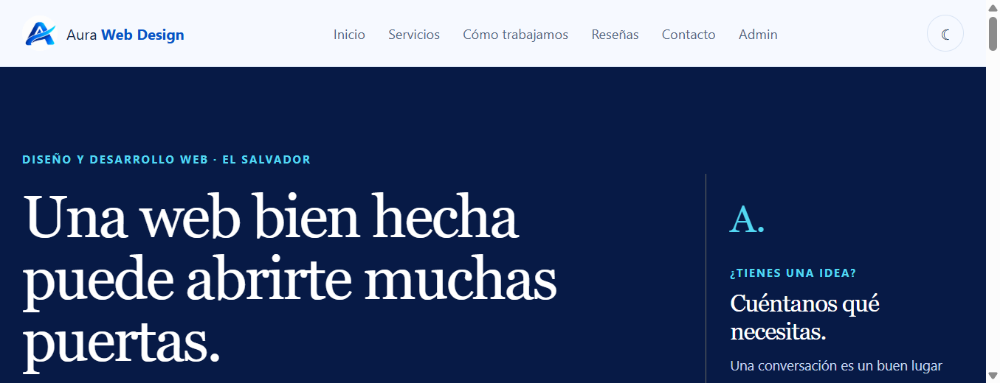
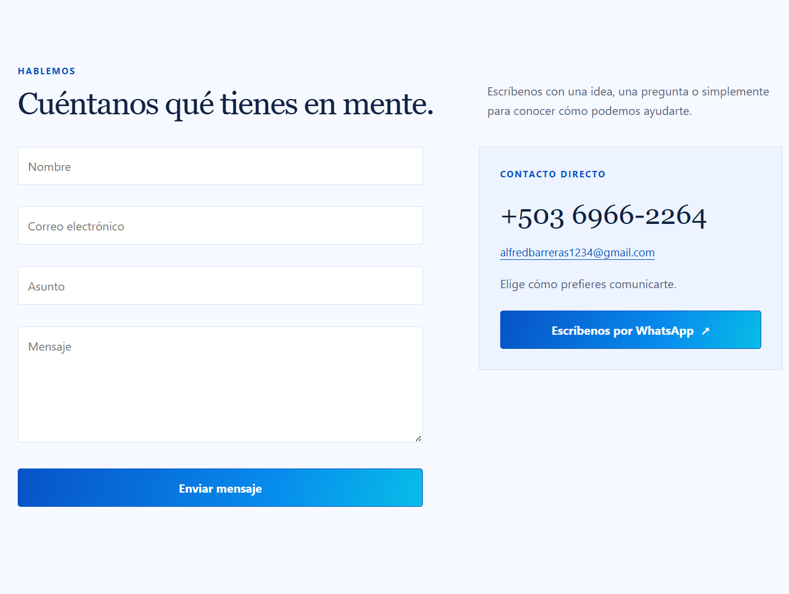

# Aura Web Design

La interfaz usa los colores del logo para que la marca se vea consistente en la navegación, los botones, los títulos y los fondos.

## Paleta

| Uso | Color |
| --- | --- |
| Azul del logo y acciones | `#0753C6` |
| Cian del logo y detalles | `#09BCE9` |
| Azul oscuro de portada y pie | `#071A46` |
| Fondo claro | `#F6F9FF` |

## Capturas

## Mensajes de contacto

El formulario envía los mensajes a **alfredbarreras1234@gmail.com** usando FormSubmit. La primera vez, FormSubmit requiere que se confirme la dirección desde el correo de activación enviado a esa bandeja. Después de confirmar, los mensajes enviados desde el formulario llegarán al correo. Si Supabase está configurado, también se guardará una copia en el panel de administración.
